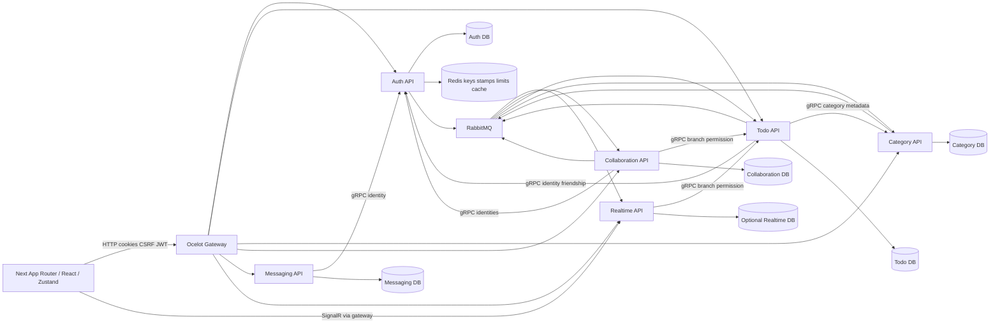

# Архитектура и потоки данных

Карта baseline, не желаемая topology. Точные source ranges: [backend evidence](evidence/backend-review.md), [distributed evidence](evidence/distributed-review.md), [frontend evidence](evidence/frontend-review.md); полный syntax inventory в [JSON](evidence/symbol-inventory.json).

## Владельцы и границы консистентности

| Владелец | Source of truth | Главный контракт / граница |
| --- | --- | --- |
| Auth | User,Friendship,RefreshToken,security stamp | JWT issuance; refresh hash/cookie; friendship authority; DataProtection key ring в Redis |
| Todo | TodoItem,share,worker,viewer preference,subtask | Owner/friend/share policy; viewer completion отдельно от global subtask completion |
| Category | Category owner and soft delete | HTTP ownership, category-deleted event для очистки ссылок |
| Collaboration | Comment,reply,system activity | Todo разрешает branch access; immutable system comments; outbox/inbox |
| Messaging | Message state | Отдельный сервис, не synonym всех Rabbit events; его полный model/validator review pending |
| Realtime | Notification/source event uniqueness | Durable DB optional; SignalR group send не доказательство client receipt |
| Frontend | View state/cache | Сервер остаётся authority для permissions; session epoch нужен на async continuation |

Базы не разделяются между runtime сервисами. Исключение — отдельный административный legacy-comment backfill migrator; его запуск требует изоляции/разрешения. Shared libraries не владеют отдельной БД.

## Сквозные сценарии

1. Login: auth page → auth-public/CSRF → Gateway → AuthenticationController → handler → Auth DB → token/cookie → Zustand. Deferred refresh после logout воспроизведён in-memory (FE-001), server revocation отдельно.
2. Task mutation: use-task-actions/route callback → api.ts → TodosController → CQRS handler → TodoDbContext и outbox → Rabbit → Collaboration/Realtime → notification store/branch reload. BE-002 показывает несколько commit, поэтому «outbox присутствует» не доказывает atomic operation.
3. Category delete: owner check → soft delete/save → domain dispatch → outbox. BE-001: первый commit до события. Нужен stage-before-save, сохранение viewer category semantics.
4. Account deletion: Auth durable event → три UserDeleted consumers. DIST-001: одинаковое simple handler name превращает ожидаемый fan-out в competing queue. Каждый домен очищает только свои записи.
5. Branch: page/hooks → SignalR JoinTask → Todo permission RPC → group. DIST-004: join authorization не отзывает уже выданную подписку. FE-003: позднее connect может join после cleanup.
6. Notifications: event → persist source ID → SignalR → client ingest; list/summary REST для восстановления. DIST-005: retry после successful persist может подавить lost push; DIST-006: timestamp-only cursor теряет ties; FE-002: поздний load возвращает старый аккаунт.
7. Search/notices: palette snapshot и lazy content; toast timers/undo находятся в отдельных stores/components. Исторические stall/TTL исправления есть; visual verification остаётся отдельной проверкой.

## Cross-cutting и startup

Web entrypoints: семь Program.cs; middleware/hosted registration перечислены с path:line в symbol inventory. Shared gRPC service-key interceptors защищают backplane, но не заменяют object authorization. Health live/ready фильтруют tags; DIST-003 показывает incomplete DB readiness. OutboxProcessor select/mark имеет single-processor ограничение; retry predicate уже учитывает NextRetryUtc. Inbox не универсален и не атомарен с каждым side effect. Retention по Compose активен, включая startup: запуск API может удалять данные и инициализировать schema.

API inventory статический: controllers method attributes, proto RPC, Ocelot maps. Runtime OpenAPI, все error envelopes/status combinations, all entrypoint behaviors и production listener topology не извлекались. T07/T13 проверяют 400/401/403/404/409/429/5xx, cancellation/deadline и no-PII envelopes. Не объявляются циклы/dead code только по import graph; semantic review оставшихся abstractions находится в continuation batches.
