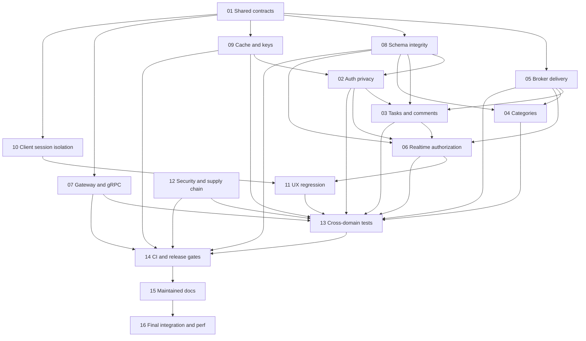

# Зависимости, ownership и критический путь

Источником порядка является [TASKS.json](TASKS.json). Найденные P1 не должны ждать косметических рефакторингов. T01 — небольшой additive contract freeze, не переписывание BuildingBlocks. T12 triage security запускается сразу и блокирует финальную интеграцию.

## Две модели исполнения

**A — последовательная:** 01 → 12 → 05 → 08 → 09 → 02 → 03 → 04 → 06 → 07 → 10 → 11 → 13 → 14 → 15 → 16. Это допустимый топологический порядок, а не требование создать 16 веток. На текущей main работать можно только в рамках новых полномочий; новые ветки/PR не создаются автоматически.

**B — ограниченная параллельная:** сначала T01 и read-only triage T12; после freeze одновременно T05/T08/T09/T07/T10 при проверенном непересечении файлов. Затем T02; T04 может идти параллельно с T02. После T02 — T03, далее T06. T11 после T10 и T06; он принимает поздний cursor/reconciliation handoff. T13–T16 последовательно. Контракты и общий package lock имеют одного писателя; параллельные npm restore запрещены. По умолчанию максимум три исполнителя и один интегратор, но безопасность ownership важнее числа.

Критический путь по зависимостям: T01 → T08 → T02 → T03 → T06 → T11 → T13 → T14 → T15 → T16. Это оценка, не измеренный календарный срок: очередь T09 или обнаруженная критическая уязвимость могут стать новым узким местом. В `estimated_size` указаны инженерные диапазоны, а не обещания модели.

## Checkpoints

| Этап | Передаваемый артефакт | Условие перехода |
| --- | --- | --- |
| Baseline | `results/T01.md`, contract diff | Существующий AddAsync не меняет semantics; consumer contract tests green |
| Security triage | `results/T12.md` | Scanner matches классифицированы без вывода значений; реальные секреты требуют отдельной rotation процедуры |
| Data/transport | `results/T05.md`, `results/T08.md`, `results/T09.md` | Erasure fan-out, DLQ, fresh/upgrade schema и key durability доказаны в изоляции |
| Domain/client | `results/T02.md`…`results/T11.md` | Нет новых privacy/UX regressions; роли и late responses проверены |
| Test consolidation | `results/T13.md` | Все критические findings имеют regression test; skips объяснены |
| CI parity | `results/T14.md` | Все обязательные checks проверенного SHA green; настройки remote отдельно утверждены |
| Docs | `results/T15.md` | Руководства и команды соответствуют внедрённому состоянию |
| Integration | `results/T16.md` | E2E, visual, isolated failures/recovery и измерения выполнены |

Stop-the-line: утечка между аккаунтами, потеря данных/events/ключей, неизвестная схема, ошибочный permission check, случайное обращение к production, чужой dirty path в scope, красный обязательный gate. Останавливается затронутый пакет; независимые read-only исследования могут продолжаться.

## Ownership

Точные наборы перечислены в TASKS. Общие документы — T15; workflows, Compose и Fly — T14; package manifests/locks и scanner rules — T12; shared persistence interfaces — T01; migration и startup schema contract — T08. T02 и T09 могут затронуть Auth DI, поэтому T09 обязательно предшествует T02. T07 и T09 проверяют пересечение `ServiceCollectionExtensions.cs` перед стартом; при пересечении T09 исполняется после T07 в одном checkout. T13 редактирует cross-system tests только после профильных test commits.
